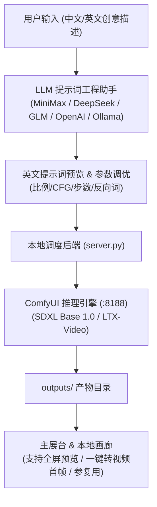

# ComfyWeb Studio · 本地 AI 文生图 / 文生视频工作台

[](https://www.python.org/)
[](https://github.com/comfyanonymous/ComfyUI)
[]()
[]()
[]()

> 基于原生轻量后端与沉浸式暗色工作室前端，专为本地消费级显卡（如 RTX 3050 Ti / 3060 / 4060 等）打造的 **ComfyUI 消费级文生图 & 文生视频一体化创作台**。

---

## ✨ 核心特性

- 🎯 **四合一多模态工作流**：
  - 🎨 **文生图 (Text-to-Image)**：基于 SDXL 1.0 的 1024 级高精出图。
  - 🖼️ **图生图 (Image-to-Image)**：支持构图与配色保留，可调 Denoise 重绘幅度。
  - 🎬 **文生视频 (Text-to-Video)**：SDXL 生成首帧 + LTX-Video 级联动态演化。
  - 🎥 **图生视频 (Image-to-Video)**：上传或选用参考图作为首帧直接生成连贯动画。
- 💡 **提示词工程与 LLM 智能改写**：
  - 中文自然语言直出，通过 LLM 自动改写为符合 Diffusion 模型的英文提示词。
  - 内置 **6 大定制风格模板**：写实摄影、电影质感、二次元动漫、奇幻概念艺术、视频动态运镜（针对 LTX-Video 镜头优化）、精准直译。
  - 双提示词工作台：支持在生图前预览、微调编辑英文提示词，或一键追加常用画质与光影灵感标签。
  - 反向提示词（Negative Prompt）预设与自定义。
- ⚡ **硬件状态与算力实时遥测**：
  - 顶栏实时监控：**CPU 使用率**、**物理内存**、**GPU 显存占用 (VRAM)**、**显卡实时功耗 (Watts)** 与 **温度 (°C)**。
  - 生图过程中主展台沉浸式呈现实时硬件负载与耗时秒数。
- 🎬 **一键工作流流转 (Workflow Continuity)**：
  - 生成满意的图片后，一键「🎬 转为视频首帧」直接切换至图生视频。
  - 一键「🖼️ 以此图重绘」、「🎲 复用种子参数」与「📥 下载高清原件」。
- 🏛️ **本地资产画廊 (Gallery)**：
  - 自动扫描本地 `outputs/` 目录历史作品，支持图片/视频分类筛选，即开即览。
- 🪶 **极简架构 & 零沉重依赖**：
  - 核心后端仅依赖 Python 标准库（外加轻量 `psutil` 与 `nvidia-smi` 监控），零繁杂包依赖，秒级启动。

---

## 🛠️ 系统架构



---

## 🚀 快速开始

### 1. 运行环境准备
* **Python**：3.10+
* **ComfyUI**：已在本地安装并正常运行（默认地址 `http://127.0.0.1:8188`）
* **推荐模型**：
  * 文生图模型：`sd_xl_base_1.0.safetensors`
  * 视频模型：`ltx-video-2b-v0.9.5.safetensors`
  * 视频文本编码器：`t5xxl_fp8_e4m3fn_scaled.safetensors`

### 2. 安装与配置
克隆本仓库到本地：
```bash
git clone https://github.com/cyz-domo/comfy-web.git
cd comfy-web
```

复制配置文件模版：
```bash
copy config.example.json config.json
```

在 `config.json` 中配置你的 ComfyUI 路径及大模型 API 地址（亦可直接在 Web 页面右上角「设置」中填入并保存）：
```json
{
  "comfy_url": "http://127.0.0.1:8188",
  "comfy_dir": "E:/ComfyUI",
  "image_checkpoint": "sd_xl_base_1.0.safetensors",
  "video_checkpoint": "ltx-video-2b-v0.9.5.safetensors",
  "video_text_encoder": "t5xxl_fp8_e4m3fn_scaled.safetensors",
  "llm": {
    "enabled": true,
    "base_url": "https://api.deepseek.com/v1",
    "api_key": "your-api-key-here",
    "model": "deepseek-chat"
  }
}
```

可选安装硬件监控依赖：
```bash
pip install psutil
```

### 3. 启动服务
双击运行 `start_web.bat`，或直接执行：
```bash
python server.py
```

终端将显示：
```text
comfy-web  ->  http://127.0.0.1:8189
ComfyUI    ->  http://127.0.0.1:8188
LLM 改写   ->  已启用 deepseek-chat
```

在浏览器打开 `http://127.0.0.1:8189` 即可开始创作。

---

## 🎨 界面预览

* **工作台主界面**：左侧为模式选择、提示词工程与参数面板；右侧为主展台与本地画廊。
* **实时监控条**：顶栏实时呈现 CPU、物理内存、显存 VRAM、GPU 功耗与核心温度。
* **独立创作中画卷**：提交新生成任务时彻底清空上一张图，展示动态步进器与实时硬件负载。

---

## 📄 开源许可

本项目遵循 [MIT License](LICENSE) 开源协议。
