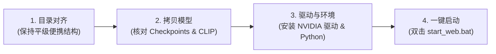

# ComfyWeb Studio · 本地 AI 创作工坊

[](https://www.python.org/)
[](https://github.com/comfyanonymous/ComfyUI)
[]()
[]()
[]()
[](LICENSE)

> 基于原生轻量后端与沉浸式暗色工作室前端，专为本地消费级显卡（如 RTX 3050 / 3060 / 4060 等）打造的 **ComfyUI 本地文生图、以图生图、图生视频与二次元角色二创一体化工作台**。

---

## 🌟 核心双工坊特性

本系统采用**顶栏双工坊架构**，右侧共享统一的实时算力遥测、主展示台与本地资产画廊：

### 1. 🎨 常规通用工坊 (Standard Studio)
- **四合一多模态创作**：
  - 🎨 **文生图 (Text-to-Image)**：基于 SDXL 1.0 的 1024 级高精画质输出。
  - 🖼️ **图生图 (Image-to-Image)**：支持构图与配色保留，可调 Denoise 重绘幅度与尺寸适配。
  - 🎬 **文生视频 (Text-to-Video)**：SDXL 生成首帧 + LTX-Video 级联动态演化。
  - 🎥 **图生视频 (Image-to-Video)**：上传或选用参考图作为起始帧，驱动连贯物理动画。
- **多风格提示词工程**：写实摄影、电影质感、动漫风格、奇幻概念艺术、视频动态运镜、精准直译。
- **一键工作流流转**：生成的图片可一键「🎬 转为视频首帧」、「🖼️ 以此图重绘」或「🎲 复用种子参数」。

### 2. 🌸 二次元角色工坊 (Anime & Character Studio)
- **Danbooru 角色库 (免 LoRA 模式 · 推荐)**：
  - 基于二次元知识库模型，原生收录海量动漫/游戏角色；
  - 内置星穹铁道（流萤、黄泉、卡芙卡等）、原神（雷电将军、芙宁娜、纳西妲等）、绝区零（艾莲、朱鸢等）、鸣潮（今汐、长离等）及热门动画（芙莉莲、波奇酱等）预设标签，支持实时分类与中英文检索。
- **外挂角色 LoRA 模式**：
  - 自动扫描本地 `models/loras/` 目录，支持 LoRA 动态加载、权重调节（0.1 ~ 1.5）与触发词绑定。
- **LLM 自然语言二创编译器 (Danbooru Compiler)**：
  - 输入纯中文脑洞剧情（如：“*穿着现代冬日黑色大衣，在雪落纷纷的便利店门口喝热咖啡，回眸温柔微笑*”）；
  - AI 自动编译为规范的 Danbooru 逗号标签，智能将**角色特征 + 画风质感 + 二创剧情**无缝融合。
- **精选二次元画师与画风注入**：
  - 新海诚光影、京阿尼清透、水彩插画手绘、轻小说插画、赛博霓虹等风格一键注入。
- **二次元画幅与参数预设**：
  - 预设 `832 × 1216`（最佳竖屏立绘）、`1216 × 832`（横屏壁纸）等黄金画幅；
  - 默认适配二次元出图最佳的 `Euler` 采样器与去崩坏负面词库，内置 NSFW 过滤开关。

### 3. ⏳ 异步生成队列与防刷新自恢复 (FIFO Queue & Auto-Reconnect)
- **单并发 FIFO 队列调度 (防显存 OOM)**：
  - 针对消费级显卡（如 4GB 显存）严格保证同一时间仅执行单个生成任务，后续任务进入标准 FIFO 队列排队自动推进，杜绝并发显存溢出与显卡驱动崩溃；
- **页面刷新 / 关闭免中断自恢复**：
  - 生成任务在后端独立线程与 ComfyUI 中持续运算；即使在生成期间**刷新网页、误关浏览器或重新开机打开页面**，前端会自动检测并无缝重新接管当前正在计算的任务、同步进度日志与实时耗时；
- **可视化队列抽屉与任务管理**：
  - **运行状态条**：实时显示当前正在执行的任务类型、提示词摘要与运行时间；
  - **排队清单抽屉**：可随时展开查看等待队列，按 `#1`、`#2` 序号展示排队位次；
  - **精细化控制与中断**：支持在排队中单独取消某项任务、一键清空队列，或对正在生成的任务执行「⏹️ 中断生成」（通过 ComfyUI `/interrupt` 接口实现毫秒级算力释放）；
- **连击加队与动态按钮文案**：
  - 显卡忙碌时，生成按钮智能变为「➕ 加入生成队列 (X 个排队中)」，无需等待上一张出图即可继续编写下一个创意，自动串联流水线出图。

### 4. ⚡ 硬件实时遥测与沉浸式体验
- **顶栏遥测条**：实时监测 **CPU**、**内存**、**GPU 显存 (VRAM)**、**显卡功耗 (Watts)** 与 **核心温度**。
- **独立创作画卷**：提交新生成任务时自动重置舞台，展示实时步进器与渲染遥测。

---

## 📁 推荐项目目录结构（便携跨机结构）

为了实现**无需修改任何绝对路径、在不同主机或移动硬盘间自由拷盘即跑**，推荐采用如下**平级便携目录结构**：

```text
AI-Studio-Root/                        <-- 推荐总便携根目录 (可任意重命名，如 D:\AI_Work / E:\PortableAI)
├── ComfyUI/                           <-- 官方 ComfyUI 目录 (或解压的 Portable 便携包)
│   ├── models/
│   │   ├── checkpoints/               <-- 【必放】生图与视频底模
│   │   │   ├── sd_xl_base_1.0.safetensors          # 常规生图底模 (~6.94GB)
│   │   │   ├── ltx-video-2b-v0.9.5.safetensors      # 视频生成底模 (~6.34GB)
│   │   │   └── waiIllustriousSDXL_v160.safetensors  # (可选) 二次元二创推荐底模 (~6.6GB)
│   │   ├── clip/                      <-- 【必放】文本编码器
│   │   │   └── t5xxl_fp8_e4m3fn_scaled.safetensors  # LTX-Video 视频文本编码器 (~4.9GB)
│   │   └── loras/                     <-- 【选放】角色与风格 LoRA 目录
│   │       └── *.safetensors                        # 各种角色 LoRA 文件
│   ├── comfyui.ps1 (或 run_nvidia_gpu.bat)
│   └── main.py
│
└── comfy-web/                         <-- 本项目 (轻量 Web 调度台)
    ├── config.json                    <-- 本地配置 (默认 comfy_dir: "../ComfyUI")
    ├── config.example.json            <-- 配置文件模版
    ├── server.py                      <-- 核心后端 (仅依赖标准库，含路径自动嗅探)
    ├── index.html                     <-- 双工坊前端界面
    ├── start_web.bat                  <-- 便携启动脚本 (自适应检测 ComfyUI)
    ├── outputs/                       <-- 本地生成作品历史 (自动按时间倒序)
    └── uploads/                       <-- 参考图上传暂存目录
```

> [!TIP]
> **为什么推荐这种结构？**
> `comfy-web` 后端已内置**相对路径解析与三级自动嗅探**机制。只要 `ComfyUI` 与 `comfy-web` 保持平级放置，无论拷贝到哪台机器的哪一个盘符（`C:`、`D:`、`E:` 或 Linux 挂载盘），系统都能**自动识别模型并直接运行，彻底免去手动修改路径的麻烦**。

---

## 🚀 快速开始

### 1. 运行环境准备
* **操作系统**：Windows 10/11 或 Linux
* **Python**：3.10+
* **显卡硬件**：NVIDIA 显卡（支持 RTX 3050 4GB 及以上，显存越大出图与视频越快）

### 2. 下载与配置
克隆或下载本仓库至 `comfy-web` 目录：
```bash
git clone https://github.com/cyz-domo/comfy-web.git
cd comfy-web
```

复制配置文件模版：
```bash
copy config.example.json config.json
```

`config.json` 默认配置：
```json
{
  "comfy_url": "http://127.0.0.1:8188",
  "comfy_dir": "../ComfyUI",
  "image_checkpoint": "sd_xl_base_1.0.safetensors",
  "video_checkpoint": "ltx-video-2b-v0.9.5.safetensors",
  "video_text_encoder": "t5xxl_fp8_e4m3fn_scaled.safetensors",
  "llm": {
    "enabled": true,
    "base_url": "https://api.deepseek.com/v1",
    "api_key": "your-api-key-here",
    "model": "deepseek-chat"
  }
}
```
*(注：LLM 配置亦可在启动后直接点击 Web 页面右上角的「⚙️ 设置」进行图形化配置与在线测试)*

可选安装系统监控依赖（用于在顶栏展示 CPU 与内存占用百分比）：
```bash
pip install psutil
```

### 3. 一键启动
双击运行 `start_web.bat`（脚本会自动探测平级 `ComfyUI` 并引导启动），或直接运行：
```bash
python server.py
```

在浏览器中打开：**`http://127.0.0.1:8189`** 即可开始创作。

---

## 📦 核心模型放置与检查清单

在跨机迁移或初次部署时，请对照以下清单确认模型文件已就位：

| 模型类型 | 建议文件名 | 放置相对路径 | 作用说明 | 必需度 |
| :--- | :--- | :--- | :--- | :--- |
| **文生图底模** | `sd_xl_base_1.0.safetensors` | `ComfyUI/models/checkpoints/` | SDXL 1.0 原生大底模，用于常规写实/插画出图 | 必须 |
| **视频底模** | `ltx-video-2b-v0.9.5.safetensors` | `ComfyUI/models/checkpoints/` | LTX-Video 2B 扩散模型，用于图生视频与文生视频 | 必须 (视频功能) |
| **文本编码器** | `t5xxl_fp8_e4m3fn_scaled.safetensors` | `ComfyUI/models/clip/` | LTX-Video 专属 T5 编码器，**缺失会导致视频报节点错误** | 必须 (视频功能) |
| **二次元底模** | `waiIllustriousSDXL_v160.safetensors` | `ComfyUI/models/checkpoints/` | Illustrious / NoobAI 体系模型，Danbooru 角色二创首选 | 推荐 |
| **角色 LoRA** | `*.safetensors` | `ComfyUI/models/loras/` | 针对特定二次元角色或风格的 LoRA 模型 | 按需添加 |

---

## 🚚 跨主机迁移全攻略 (Migration Guide)

将整个项目迁移到另一台电脑（例如从笔记本迁移到主力台式机，或部署到新服务器）时，只需遵循以下 4 步：



1. **结构保持平级**：
   确保目标主机上的 `ComfyUI` 与 `comfy-web` 放在同一目录下。
2. **核对大文件完整性**：
   通过移动硬盘或局域网快传将 `models/` 目录完整拷贝。**特别注意检查 `models/clip/` 目录下的 T5 编码器是否存在**。
3. **网络与端口排查**：
   * 确保目标主机的 `8189`（Web 前端）与 `8188`（ComfyUI 引擎）未被其他软件占用；
   * 若目标主机是局域网独立主机，可将 `config.json` 中的 `comfy_url` 改为该主机的内网 IP。
4. **性能与显存甜点建议**：
   * **4GB ~ 6GB 显存主机**：建议生图使用 `832 × 1216` 或 `1024 × 1024`（耗时约 50~65s），视频选用 49 帧极速模式；
   * **8GB ~ 12GB+ 显存主机**：无需内存分段 Offload，出图可秒级完成（8~15s），视频可放开至 81~97 帧获得更长镜头。

---

## 📄 开源许可

本项目遵循 [MIT License](LICENSE) 开源协议。
